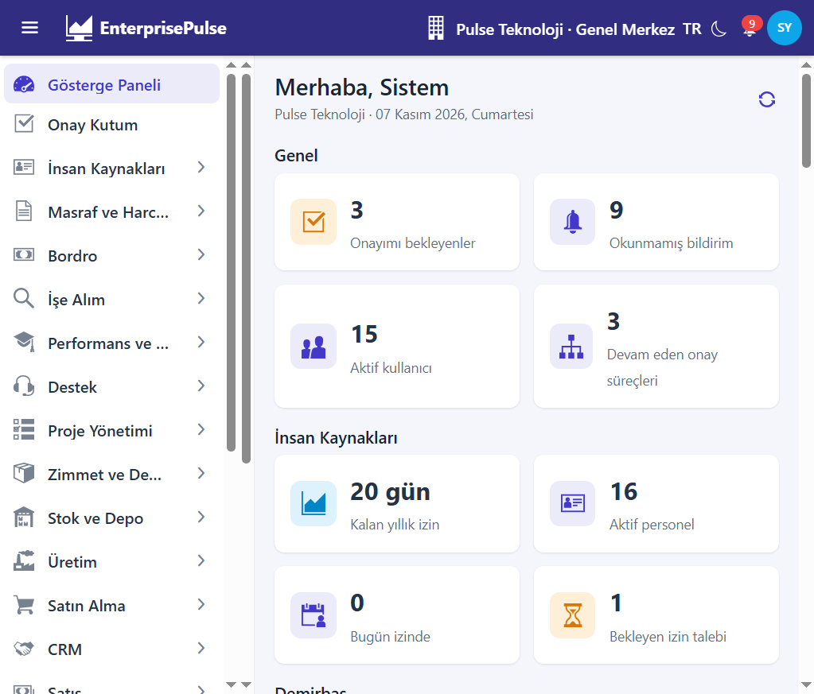
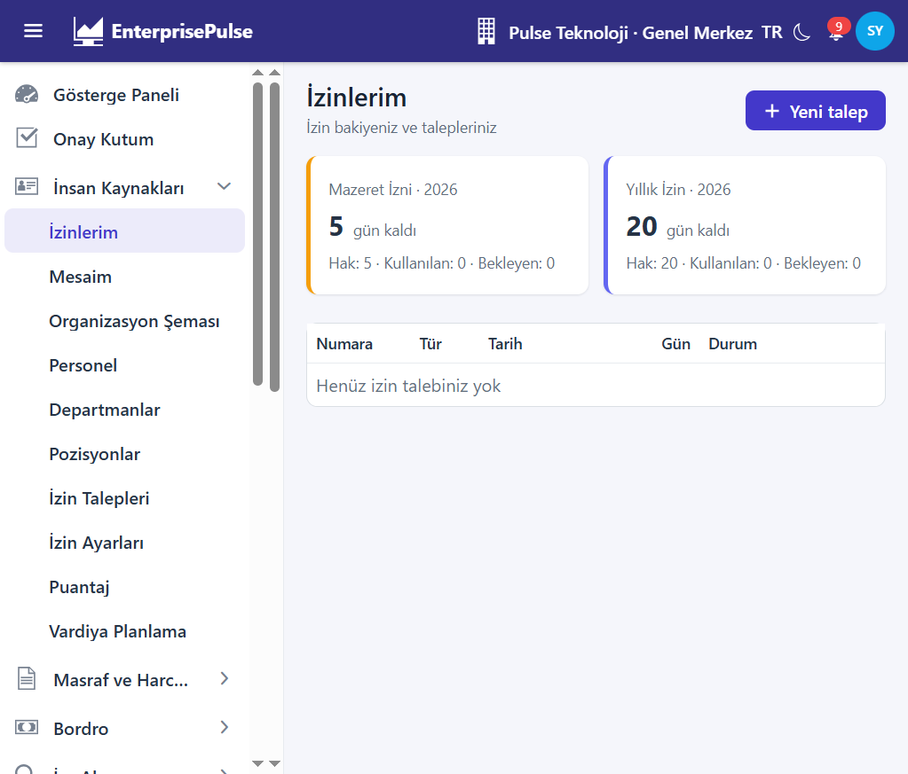
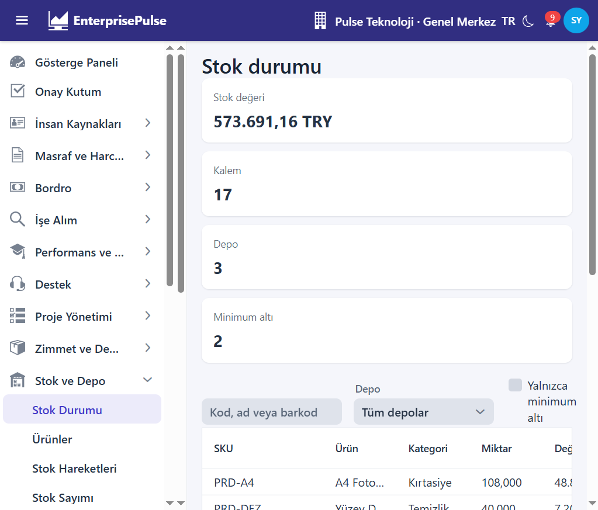
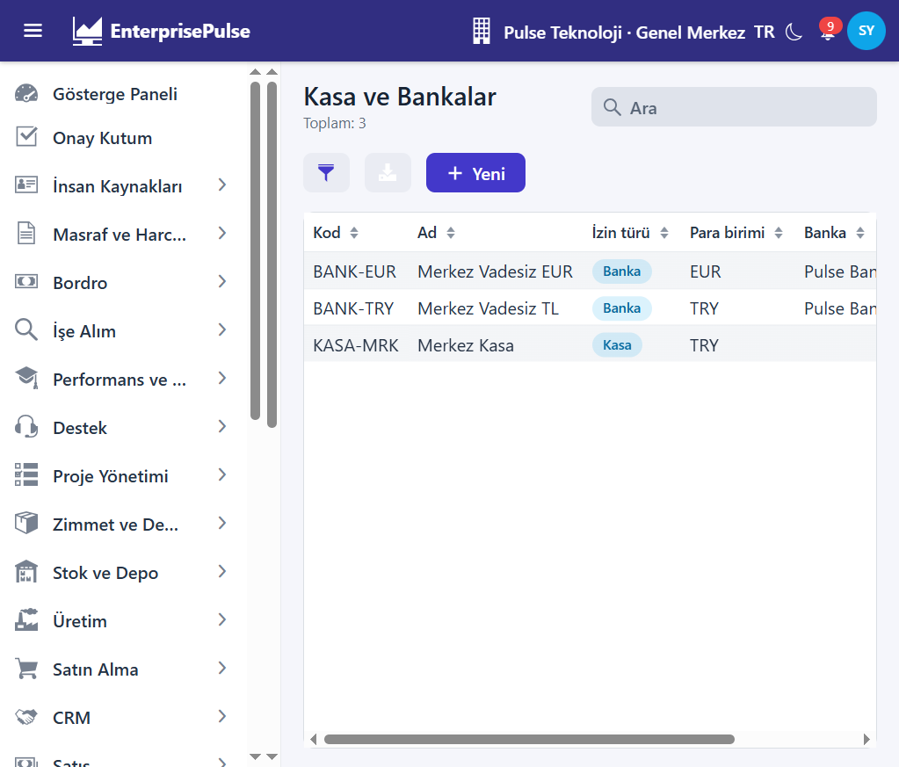
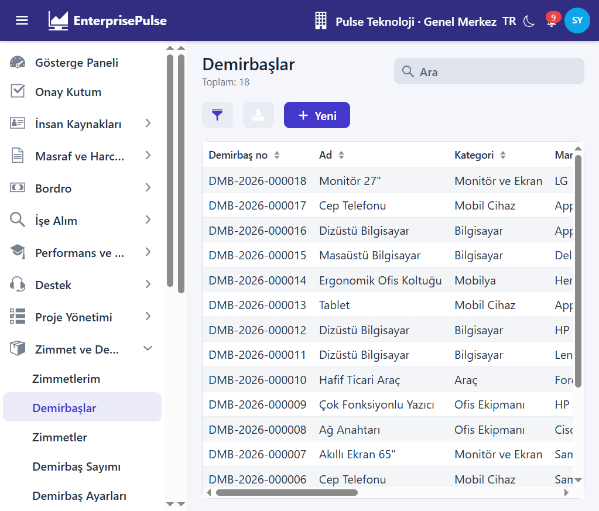
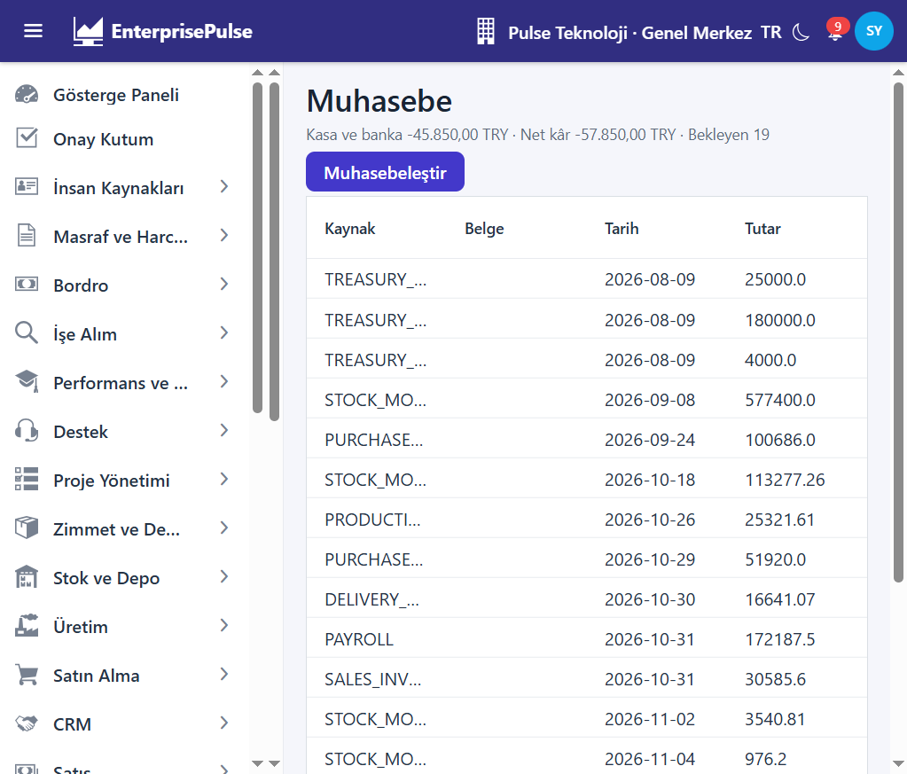
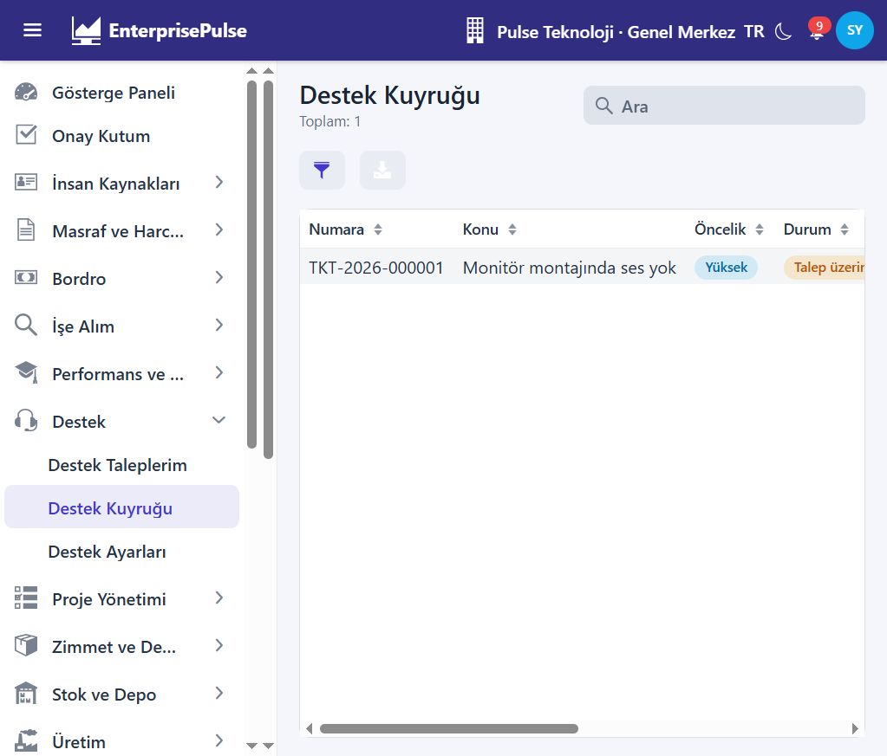
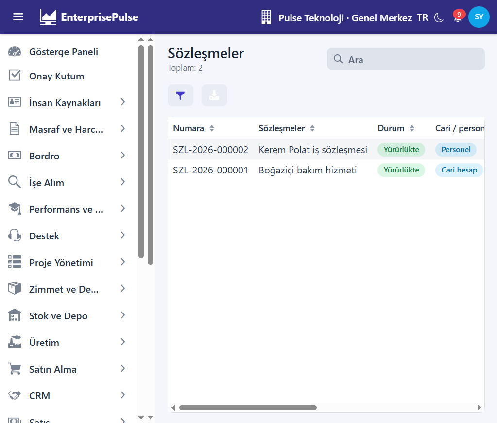
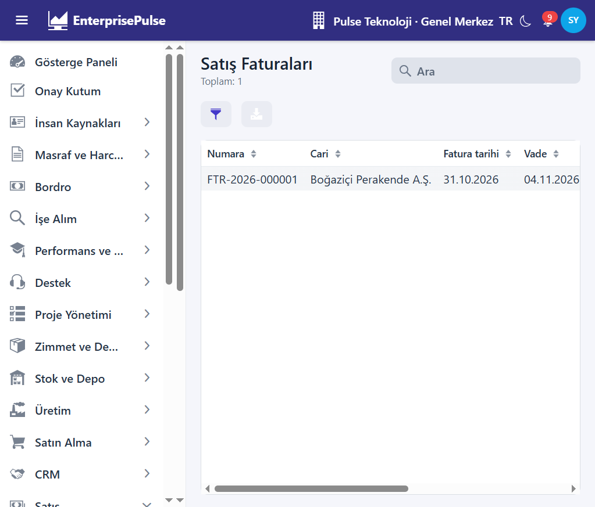

# EnterprisePulse Java

[](https://openjdk.org/)
[](https://spring.io/projects/spring-boot)
[](https://vaadin.com/)
[](https://www.postgresql.org/)
[](https://flywaydb.org/)
[](https://maven.apache.org/)

**EnterprisePulse**, çok şirketli (multi-tenant) kurumsal bir ERP sistemidir. Bu repo, NestJS / React orijinalinin **Spring Boot 3.5 + Vaadin 24** ile yeniden yazımıdır (Java 17): API ve web ayrı Maven modülleri.

| Repo | İçerik |
| --- | --- |
| **EnterprisePulse.Java** (bu repo) | Spring Boot API + Vaadin arayüz |
| [EnterprisePulse.NET](https://github.com/hamzamaral/EnterprisePulse.NET) | ASP.NET Core 10 + Blazor yeniden yazımı |
| [EnterprisePulse](https://github.com/hamzamaral/EnterprisePulse) | NestJS / React orijinali, yol haritası, ADR |
| [enterprise-pulse-api](https://github.com/hamzamaral/enterprise-pulse-api) · [enterprise-pulse-web](https://github.com/hamzamaral/enterprise-pulse-web) | Orijinal API / SPA repoları |



> Demo seed **Pulse Teknoloji · Genel Merkez** şirketinde doludur. Üst bardan **Pulse Lojistik** seçerseniz çoğu liste boş görünür — ikinci şirket için operasyonel seed yoktur.

## Ekranlar

| | |
| --- | --- |
|  |  |
| **Gösterge paneli:** yetkiye göre KPI kartları | **İzinlerim:** yıllık / mazeret bakiyesi, yeni talep |
|  |  |
| **Stok durumu:** stok değeri, kritik kalemler, depolar | **Kasa ve bankalar:** `KASA-MRK`, `BANK-TRY`, `BANK-EUR` |
|  |  |
| **Demirbaşlar:** zimmetli / depoda / hurda kayıtları | **Muhasebe:** bekleyen belgeler, muhasebeleştir |
|  |  |
| **Destek kuyruğu:** öncelik ve durum etiketleri | **Sözleşmeler:** cari / personel, yürürlükte |
|  | |
| **Satış faturaları:** cari, vade, kısmi tahsilat | |

## Hızlı başlangıç

Gereksinimler: **JDK 17+**, Maven Wrapper (dahil), Docker.

```bash
docker compose up -d
# Postgres 5452 · RustFS 9020/9021 · Mailpit 1045/8045

./mvnw -pl api spring-boot:run
# http://localhost:8180  ·  Swagger: /swagger-ui.html

./mvnw -pl web spring-boot:run
# http://localhost:8181
```

API açılışta Flyway migration’larını uygular ve demo verisini yükler.

### Demo kullanıcılar

| Rol | E-posta | Şifre |
| --- | --- | --- |
| Sistem yöneticisi | `admin@enterprisepulse.dev` | `Admin123!` |
| Müdür | `manager@enterprisepulse.dev` | `Manager123!` |
| Personel | `employee@enterprisepulse.dev` | `Employee123!` |

### Yerel servisler

| Servis | Adres |
| --- | --- |
| API | http://localhost:8180 |
| Swagger | http://localhost:8180/swagger-ui.html |
| Web (Vaadin) | http://localhost:8181 |
| Mailpit | http://localhost:8045 |
| RustFS (S3) | http://localhost:9021 |

### Testler

```bash
./mvnw -pl api test
# Her koşu Postgres 5452 üzerinde geçici bir veritabanı açar
```

Son koşuda: **54/54** geçti.

## Özellikler

- **Platform:** JWT giriş, şirket / şube değiştirme, kullanıcı · rol · izin, denetim kaydı, STOMP bildirimleri, onay kutusu, ayarlar. Periyodik işler **`@Scheduled` + ShedLock** (Redis / BullMQ yok). Kayıt detayında 3 sütunlu tanım listesi, durum/koşul rozetleri ve sekme kabuğu.

- **Gösterge paneli:** yetkiye göre İK, zimmet, stok ve finans KPI’ları; personel için kalan izin ve self-servis özetleri.
- **İnsan Kaynakları:** personel, departman, pozisyon, organizasyon şeması, izin talebi ve çok adımlı onay, **İzinlerim** / **Mesaim**, puantaj, vardiya planı.
- **Zimmet ve Demirbaş:** demirbaş kartı, QR etiket, zimmet / iade / devir, amortisman, sayım, **Zimmetlerim**.
- **Stok ve Depo:** stok durumu, ürün / varyant, lot · seri, giriş / çıkış / transfer / düzeltme, sayım.
- **Satın Alma / Satış / Finans:** teklif, sipariş, irsaliye, fatura; cari hesaplar; kasa / banka, çek · senet, ödeme / tahsilat, yaşlandırma.
- **CRM:** potansiyel müşteri, fırsat hattı, aktiviteler.
- **Masraf ve Harcırah:** self-servis formlar, onay, finans ödemesi.
- **Proje Yönetimi:** proje, ekip, görev panosu, zaman çizelgesi.
- **Bordro / İşe Alım / Performans / Eğitim:** dönem hesaplama, ücret pusulası; iş ilanı ve başvuru hattı; değerlendirme dönemi; eğitim oturumları ve uyum.
- **Destek / Sözleşme / Bütçe / Filo:** SLA’lı ticket kuyruğu, sözleşme takvimi, departman bütçesi, araç · yakıt · belge uyarıları.
- **Muhasebe / e-Fatura / Üretim:** tekdüzen hesap planı, yevmiye, mizan · bilanço · gelir tablosu; UBL-TR kuyruk simülasyonu; ürün ağacı, iş emri, MRP.

## Modüller (menü)

| Bölüm | Örnek ekranlar |
| --- | --- |
| Genel | Gösterge paneli, Onay kutum |
| İnsan Kaynakları | İzinlerim, Mesaim, Personel, Puantaj, Vardiya |
| Masraf ve Harcırah | Masraflarım, Masraf formları |
| Bordro | Bordrolar, Bordrolarım, Ücretler |
| İşe Alım | İş ilanları, Adaylar, Mülakatlarım |
| Performans ve Eğitim | Değerlendirmeler, Eğitimlerim |
| Destek | Destek kuyruğu, Destek taleplerim |
| Proje Yönetimi | Projeler, Görevlerim, Zaman çizelgesi |
| Zimmet ve Demirbaş | Demirbaşlar, Zimmetlerim, Sayım |
| Stok ve Depo | Stok durumu, Ürünler, Hareketler |
| Üretim | İş emirleri, Ürün ağacı, MRP |
| Satın Alma / Satış | Teklif, sipariş, irsaliye, fatura |
| CRM | Fırsatlar, Potansiyel müşteriler, Aktiviteler |
| Cari ve Finans | Cari hesaplar, Kasa ve bankalar, Çekler, Ödemeler |
| Muhasebe | Panel, Yevmiye, Hesap planı, Mizan, e-Fatura |
| Sözleşmeler / Bütçe / Filo | Sözleşmeler, Bütçeler, Araçlar |
| Sistem | Kullanıcılar, Roller, Ayarlar, Denetim |

## Yapı

```
pom.xml                    # Maven parent
├── api/                   # Spring Boot: JPA, güvenlik, Flyway, STOMP, modül servisleri, seed
├── web/                   # Vaadin 24: metadata’dan liste / form / detay + modül sayfaları
├── tools/codegen          # Prisma şemasından Java varlık + metadata.json
└── docker-compose.yml
```

```bash
node tools/codegen/emit-java.mjs
```

## Belgeler (PDF benzeri kılavuzlar)

Yazıcıdan veya tarayıcıda **PDF olarak yazdır** ile PDF üretebilirsiniz.

| Belge | İçerik |
| --- | --- |
| [Kullanıcı / ekran kılavuzu](docs/kullanici-kilavuzu.md) ([HTML → PDF](docs/kullanici-kilavuzu.html)) | Tüm menü sayfaları modül gruplarıyla (ör. 2. İK → 2.1 İzinlerim), ne işe yarar, nasıl kullanılır |
| [Teknik kılavuz](docs/teknik-kilavuz.md) ([HTML → PDF](docs/teknik-kilavuz.html)) | Backend/frontend stack, paket yapısı, platform kalıpları, her modülün servis / API / Vaadin / seed / iş kuralları |

## Kardeş projeler

Aynı domain modeli üç stack’te:

| Proje | API | UI | İş kuyruğu | Portlar |
| --- | --- | --- | --- | --- |
| [EnterprisePulse](https://github.com/hamzamaral/EnterprisePulse) | NestJS | React | Redis + BullMQ | 3000 / 5173 |
| [EnterprisePulse.NET](https://github.com/hamzamaral/EnterprisePulse.NET) | ASP.NET 10 | Blazor | Hangfire + Postgres | 5100 / 5101 |
| **EnterprisePulse.Java** | Spring Boot 3.5 | Vaadin 24 | `@Scheduled` + ShedLock | 8180 / 8181 |

## Lisans

Özel / eğitim amaçlı yeniden yazım. Orijinal yol haritası: [EnterprisePulse](https://github.com/hamzamaral/EnterprisePulse).
